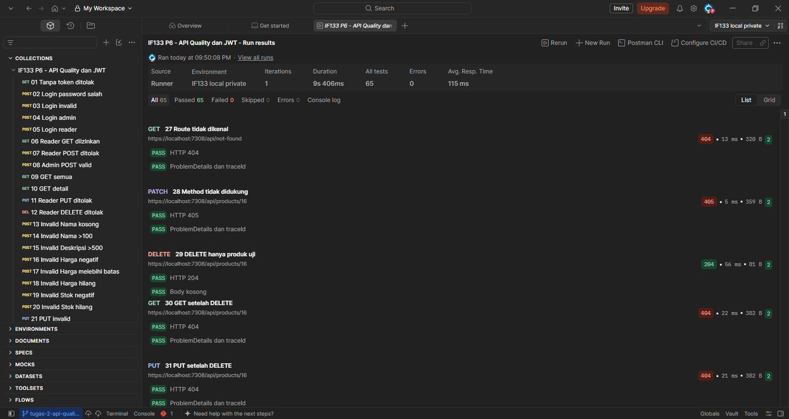
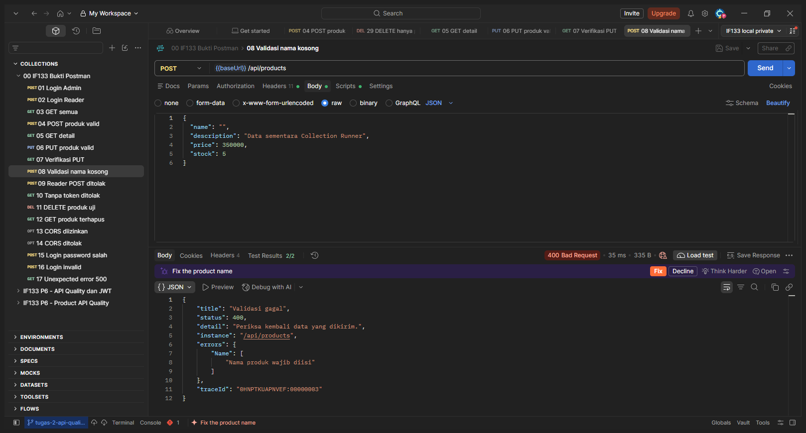
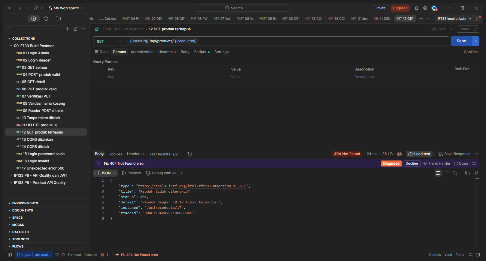

# IF133 P6 Final API Quality, JWT, dan Pengujian

- **Nama:** Anathapindika Surja Putra
- **NIM:** 1003240007
- **Kelas:** Informatika Eksekutif
- **Mata kuliah:** IF133 — Pemrograman .NET, Pertemuan 6
- **Nama paket pengumpulan:** `IF133_P6_1003240007_AnathapindikaSurjaPutra`

## 1. Tujuan dan dasar pengerjaan

Refactor REST API Produk agar kontrak eksternal terpisah dari entity, request tervalidasi, error konsisten, logging dapat ditelusuri, konfigurasi CORS/environment aman, serta login dan pembatasan hak akses berfungsi.

Acuan: `P06_Tugas_2_Final_API_Quality.pdf`, bagian C–F. Bagian D meminta source code final, Postman collection atau bukti Swagger, README pengujian, serta dokumentasi singkat error/logging/CORS. Rubrik E juga mencantumkan authentication/authorization; karena itu JWT dan role diterapkan, bukan sekadar `AddAuthorization`.

**Dokumen ini mencatat eksekusi nyata, bukan hanya hasil yang diharapkan.** Screenshot berada di `docs/screenshots/`, mengikuti rekomendasi percakapan pendukung. Source tetap menjadi luaran utama; screenshot tidak menggantikan source.

## 2. Ringkasan hasil aktual

Run otomatis lengkap: **08 November 2026, 21:11:24 WIB**. Screenshot Postman diambil sesudahnya pada tanggal yang sama. Server verifikasi Development menggunakan `https://localhost:7308`; instance fault terpisah menggunakan `https://localhost:7309`. Port tersebut khusus pengujian, bukan perubahan launch profile normal.

| Verifikasi | Hasil aktual | Bukti |
|---|---|---|
| Build .NET 10 | Berhasil; 0 warning, 0 error | [Output build aktual](docs/test-results/build-results.txt) |
| Integrasi HTTP Python | 54/54 skenario PASS | [JSON request/response dan assertion](docs/test-results/api-results.json) |
| Postman collection via Newman 6.2.3 | 32 requests; 65 assertions; 0 failure | [JSON ringkas](docs/test-results/newman-results.json), [console](docs/test-results/newman-console.txt) |
| Startup dan Production defaults | 11/11 pemeriksaan PASS | [JSON](docs/test-results/startup-results.json) |
| Unit test helper konfigurasi | 11/11 PASS | [Output unittest](docs/test-results/configuration-unit-tests.txt) |
| Logging dan korelasi traceId | 11 pemeriksaan PASS | [Verifikasi](docs/test-results/logging-verification.json), [cuplikan log](docs/test-results/server-log-excerpt.txt) |
| Data awal setelah kedua runner | Produk ID 7, 8, 9 tetap sama; produk uji sudah dihapus | [Bukti read-back](docs/test-results/data-preservation.json) |
| Screenshot | 16 screenshot Postman asli + 1 screenshot Swagger asli | [Indeks screenshot](docs/screenshots/README.md) |

Angka requests, skenario, dan assertions merupakan ukuran yang berbeda dan tidak dijumlahkan sebagai satu jumlah pengujian unik. Newman menampilkan deprecation warning dari dependensinya, tetapi tidak ada assertion yang gagal; build aplikasi tetap tanpa warning.

## 3. Kesesuaian dengan rubrik

| Kriteria | Bobot | Implementasi dan bukti |
|---|---:|---|
| DTO, validasi, error handling | 25% | `CreateProductDto`, `UpdateProductDto`, `ProductResponseDto`, DTO login; DataAnnotations; ProblemDetails 400/401/403/404/405/415/500. Kasus 17–33 dan 45–53. |
| Logging dan konfigurasi | 20% | `ILogger`, `traceId`, konfigurasi User Secrets/environment, CORS allowlist, validasi konfigurasi saat startup. Log dan 11 pemeriksaan startup/Production. |
| Authentication dan authorization | 30% | Login JWT HS256; signature/issuer/audience/lifetime diperiksa; GET untuk Admin/Reader, mutasi hanya Admin. Kasus 01–16 dan 37–41. |
| Pengujian dan dokumentasi keamanan | 25% | Skenario positif/negatif, collection dieksekusi Newman, request-response JSON, screenshot Postman asli dan dokumentasi alur security. |

Tabel ini memetakan implementasi terhadap rubrik, bukan menjamin nilai dosen atau menyatakan aplikasi siap produksi.

## 4. Struktur dan teknologi

```text
Controllers/        AuthController.cs, ProductController.cs
DTOs/               kontrak create/update/response produk dan login
Entities/           Product.cs (model database, bukan request body)
Data/               AppDbContext.cs
Migrations/         migrasi EF Core yang sudah ada
Configuration/      validasi JWT dan akun pada startup
OpenApi/            filter dokumentasi anonymous operation/error content type
scripts/            configure_local.py, test_api.py, test_startup.py
Properties/         launchSettings.json
Program.cs          konfigurasi service dan HTTP pipeline
appsettings.json    logging; connection string kosong (tidak berisi credential)
Products.postman_collection.json
openapi.json        ekspor Swagger runtime, bukan spesifikasi hasil perkiraan
README.md
 docs/
  screenshots/      PNG, indeks, manifest pemetaan kasus
  test-results/     JSON, output build/unit test dan cuplikan log aktual
```

Lingkungan yang diverifikasi: Windows 11, .NET SDK 10.0.401, ASP.NET Core runtime 10.0.12, EF CLI 10.0.13, MySQL lokal. Paket proyek meliputi EF Core Design 10.0.14, `Microting.EntityFrameworkCore.MySql` 10.0.13, JwtBearer 10.0.14, dan Swashbuckle 10.3.0. Versi direct dependency sudah dipin sesuai paket yang diuji. Node.js diperlukan hanya jika menjalankan Newman; Python 3 diperlukan untuk helper/pengujian.

## 5. Persiapan dan menjalankan aplikasi

Jalankan perintah dari folder yang berisi `IF133.Tugas1.Api.csproj`. Aktifkan MySQL lokal/Laragon terlebih dahulu.

```powershell
dotnet restore
python scripts/configure_local.py
dotnet ef database update
dotnet build
dotnet dev-certs https --trust
dotnet run --launch-profile https
```

`configure_local.py` meminta connection string dan dua password melalui input tersembunyi. Isi connection string yang cocok dengan MySQL Anda. Jika User Secret connection string sudah ada pada komputer ini, input kosong mempertahankannya. Panjang password harus 12–1024 unit UTF-16, bukan hanya whitespace, dengan konfirmasi cocok; whitespace pada password yang valid tetap dipertahankan. Penghitungan ini mengikuti batas `StringLength` .NET, termasuk untuk emoji/non-BMP Unicode. Tidak ada password default yang dibagikan. Username konfigurasi dibatasi maksimal 100 karakter agar konsisten dengan DTO login.

- Akun `admin` memiliki role `Admin`; `reader` memiliki role `Reader`.
- Helper menghasilkan JWT key acak dan hash PBKDF2-SHA256 (salt acak, 210000 iterasi), kemudian menyimpannya melalui .NET User Secrets.
- `UserSecretsId` proyek: `if133-tugas1-api-local`. Secret berada di profil pengguna, **di luar repository**. User Secrets bukan penyimpanan terenkripsi dan tidak digunakan sebagai secret store produksi.
- Konfigurasi pengujian lokal sudah pernah dibuat; **jalankan helper untuk menetapkan password yang Anda ketahui sebelum demo**. Password sementara pengujian tidak dimasukkan ke laporan atau collection.
- `dotnet ef database update` diperlukan pada database baru; pengujian laporan ini memakai skema yang sudah ada dan tidak menerapkan migrasi baru.
- Port launch profile HTTPS normal adalah `https://localhost:7216` (HTTP `5068`). Buka `https://localhost:7216/swagger`.
- **Hentikan/restart instance lama milik Anda sebelum menjalankan source final.** Instance lama pada 7216/5068 tidak dihentikan oleh proses penyusunan laporan; proses lama dapat tetap melayani kode tanpa JWT.
- Jika build gagal karena executable dipakai proses lain, hentikan instance aplikasi Anda secara normal. Verifikasi laporan menggunakan output build terpisah agar tidak mengganggu instance tersebut.

Build terpisah yang dipakai untuk bukti:

```powershell
dotnet build IF133.Tugas1.Api.csproj --nologo -o "$env:LOCALAPPDATA/hermes/cache/scratch/if133-reviewed-build"
```

Pada komputer baru, jika `dotnet ef` belum ada: pasang `dotnet-ef` versi yang kompatibel dengan EF Core 10 proyek. Jangan memasukkan credential database ke source atau screenshot.

### Nama konfigurasi

| Konfigurasi | Fungsi |
|---|---|
| `ConnectionStrings:DefaultConnection` | Koneksi MySQL; kosong dalam source |
| `Jwt:Key` | Key acak minimal 32 byte, disimpan sebagai secret |
| `Jwt:Issuer`, `Jwt:Audience` | Identitas penerbit dan penerima token |
| `Jwt:ExpiresMinutes` | Default 30 menit; rentang startup 1–60 |
| `Auth:Users:0:Username/Role/PasswordHash` | Akun Admin dari konfigurasi |
| `Auth:Users:1:Username/Role/PasswordHash` | Akun Reader dari konfigurasi |
| `Cors:AllowedOrigins` | Allowlist origin frontend |

Untuk environment variable, ganti `:` dengan `__`, misalnya `Jwt__Key`. Production harus menyediakan secret melalui environment/secret manager; User Secrets development tidak otomatis tersedia. Startup menolak key pendek, issuer/audience kosong, masa berlaku tidak valid, hash plaintext, username duplikat, dan role selain Admin/Reader.

## 6. Kontrak endpoint dan hak akses

| Method | Endpoint | Akses | Sukses | Error utama |
|---|---|---|---|---|
| POST | `/api/auth/login` | Anonymous | 200 + token | 400, 401 |
| GET | `/api/products` | Admin / Reader | 200 array DTO | 401, 403, 500 |
| GET | `/api/products/{id}` | Admin / Reader | 200 DTO | 401, 403, 404, 500 |
| POST | `/api/products` | Admin | 201 + `Location` + DTO | 400, 401, 403, 415, 500 |
| PUT | `/api/products/{id}` | Admin | 204, body kosong | 400, 401, 403, 404, 415, 500 |
| DELETE | `/api/products/{id}` | Admin | 204, body kosong | 401, 403, 404, 500 |

`OPTIONS` digunakan untuk preflight CORS; bukan operasi CRUD tambahan. Route tidak dikenal dan ID bukan integer menghasilkan 404; method PATCH yang tidak didukung menghasilkan 405.

Contoh request create/update (contoh format, bukan credential):

```json
{"name":"Keyboard Mechanical","description":"Keyboard 75%","price":350000,"stock":5}
```

### DTO dan validasi

- Entity `Product` tetap digunakan oleh EF Core; request menggunakan DTO, response dipetakan melalui `ToDto`.
- `Name`: required, tidak menerima kosong/whitespace, maksimal 100 karakter; nama valid di-trim sebelum disimpan.
- `Description`: opsional, maksimal 500 karakter.
- `Price`: required dan nullable pada request agar field hilang/null dapat ditolak; rentang 0–999999999.
- `Stock`: required dan nullable pada request; rentang 0–2147483647.
- `UpdateProductDto` mewarisi validasi create. PUT merupakan pembaruan lengkap, bukan PATCH; ID target dari URL.
- Response produk hanya memuat `id`, `name`, `description`, `price`, `stock`; konfigurasi akun/hash/key tidak terekspos.

## 7. Alur authentication dan authorization

1. Client mengirim username/password ke `POST /api/auth/login` melalui HTTPS.
2. DTO login memvalidasi field required dan panjang input.
3. Server mencari akun konfigurasi dan memverifikasi PBKDF2-SHA256; perbandingan hash menggunakan constant-time comparison. Akun tidak dikenal tetap menjalankan derivasi untuk membatasi perbedaan waktu.
4. Jika salah, respons 401 generik tidak membedakan username yang tidak ada dengan password salah. Jika benar, server mengembalikan `accessToken`, `tokenType: Bearer`, `expiresIn`.
5. Token berisi `sub`, `role`, `jti`, issuer, audience, not-before dan expiry; ditandatangani HS256. Password/hash tidak menjadi claim.
6. Request berikutnya menggunakan header `Authorization: Bearer <accessToken>`.
7. Middleware memeriksa signature, algoritma HS256, issuer, audience, expiry dan not-before; toleransi waktu 30 detik.
8. Tanpa token/token tidak valid → 401. Token Reader mengakses operasi mutasi → 403. Admin dapat CRUD, Reader hanya membaca.

Ini implementasi pembelajaran dengan akun dari konfigurasi, bukan identity provider produksi. Belum mencakup registrasi, refresh/revocation token, reset password mandiri, lockout/rate limiting login, atau pengelolaan user berbasis database. CORS bukan pengganti authentication/authorization. Untuk deployment produksi perlu penguatan tambahan dan layanan identitas yang sesuai.

## 8. Alur error handling

```text
Request → routing → CORS → authentication → authorization
        → ApiController/validasi → controller → EF Core/MySQL

Input invalid            → 400 ValidationProblemDetails + errors + traceId
Token hilang/tidak valid → 401 ProblemDetails + WWW-Authenticate: Bearer
Role tidak berhak        → 403 ProblemDetails
Produk tidak ditemukan   → 404 ProblemDetails
Method/media type salah  → 405 / 415 ProblemDetails
Exception tak terduga    → global exception handler → log server → 500 generik
```

`AddProblemDetails` menyisipkan `instance` dan `traceId`. `UseStatusCodePages` mengisi error status yang semula tidak mempunyai body. Handler global menyimpan detail exception di server dan tidak mengirim stack trace/credential ke client. Penambahan `traceId` ganda pada respons controller diperbaiki agar not-found tidak berubah menjadi 500. Response 204 tidak mempunyai body.

Contoh respons **aktual** dari pengujian (ID/trace mengikuti run ini):

**400 validasi nama kosong:**

```json
{
  "title": "Validasi gagal",
  "status": 400,
  "detail": "Periksa kembali data yang dikirim.",
  "instance": "/api/products",
  "errors": {
    "Name": [
      "Nama produk wajib diisi"
    ]
  },
  "traceId": "0HNPTK8JGOBS1:00000001"
}
```

**404 produk uji yang sudah dihapus:**

```json
{
  "type": "https://tools.ietf.org/html/rfc9110#section-15.5.5",
  "title": "Produk tidak ditemukan",
  "status": 404,
  "detail": "Produk dengan ID 14 tidak tersedia.",
  "instance": "/api/products/14",
  "traceId": "0HNPTK8JGOBT2:00000001"
}
```

**500 pada instance fault terisolasi:**

```json
{
  "type": "https://tools.ietf.org/html/rfc9110#section-15.6.1",
  "title": "Terjadi kesalahan pada server",
  "status": 500,
  "detail": "Silakan coba kembali atau hubungi administrator.",
  "instance": "/api/products",
  "traceId": "0HNPTK8LAD4KK:00000001"
}
```

Pengujian 500 menggunakan executable yang sama dengan override koneksi hanya pada proses fault, ke `127.0.0.1:1` dan database fiktif. Tidak mematikan MySQL, tidak mengubah database pengguna, dan tidak menambahkan endpoint debug berbahaya. Instance normal tetap berfungsi.

## 9. Logging

`ILogger` mencatat login berhasil/gagal, validasi gagal, jumlah produk dibaca, ID produk dibuat/diubah/dihapus, warning not-found, serta exception tak terduga. Pesan memuat `traceId` untuk menghubungkan respons client dengan console server.

Bukti: [cuplikan log aktual](docs/test-results/server-log-excerpt.txt), [verifikasi 11 pemeriksaan](docs/test-results/logging-verification.json). TraceId respons 400, 404, dan 500 telah dicocokkan dengan log. Password, token dan signing key tidak dicatat dalam bukti. Log normal ditulis ke console; file bukti merupakan hasil penangkapan console selama pengujian, bukan klaim aplikasi memiliki file logger permanen.

## 10. CORS dan environment

Policy `FrontendPolicy` menggunakan origin yang dikonfigurasi. Default Development hanya `http://localhost:5173`, method GET/POST/PUT/DELETE, header Content-Type/Authorization. Tidak menggunakan `AllowAnyOrigin` atau wildcard dengan credential.

Contoh konfigurasi **nonsecret** pada `appsettings.Development.json` bila origin perlu diganti:

```json
{"Cors":{"AllowedOrigins":["http://localhost:5173"]}}
```

| Pengujian aktual | Status | Pemeriksaan yang menentukan |
|---|---:|---|
| Preflight origin `http://localhost:5173` | 204 | `Access-Control-Allow-Origin` sesuai origin |
| Preflight origin `http://localhost:9999` | 204 | Tidak ada `Access-Control-Allow-Origin` |
| GET origin yang diizinkan | 200 | Header allow-origin tersedia |
| Production tanpa allowlist | 204 pada preflight | Tidak ada allow-origin; deny by default |

**Origin ditolak tidak harus menghasilkan 403**: browser menolak akses karena header izin CORS tidak diberikan. Client non-browser tidak dibatasi oleh CORS. Swagger hanya aktif dalam Development; pengujian Production mengonfirmasi URL Swagger mengembalikan 404. Production diuji memakai HTTP loopback hanya pada proses verifikasi, bukan sebagai contoh deployment publik; deployment tetap harus memakai HTTPS.

## 11. Menjalankan Postman / Newman / Swagger

### Postman

1. Restart aplikasi agar source final/JWT aktif, lalu import `Products.postman_collection.json`.
2. Buat environment **lokal yang tidak dikumpulkan**, isi `baseUrl` (normal: `https://localhost:7216`), `adminUsername=admin`, `readerUsername=reader`, serta password yang ditetapkan melalui helper. Tandai password sebagai sensitive.
3. Jalankan seluruh collection berurutan. Request login menyimpan token secara otomatis; POST valid menyimpan `productId`; request terakhir menghapus hanya produk runner dan memverifikasi 404.
4. Jika create gagal, collection menghentikan urutan agar tidak menargetkan ID yang salah. Jangan mengganti `productId` dengan produk pribadi.
5. Setelah demo, kosongkan token/password lokal sebelum mengekspor collection. File collection yang diserahkan berisi nilai credential kosong.

### Newman

Setelah membuat environment Postman lokal di luar repo:

```powershell
$env:NODE_USE_SYSTEM_CA = "1"
npx --yes newman run Products.postman_collection.json -e "<path-environment-lokal-di-luar-repo>.json" --reporters cli
```

Gunakan sertifikat development yang dipercaya. Pengujian ini tidak menggunakan `--insecure` atau menonaktifkan verifikasi TLS. Jangan mengumpulkan ekspor JSON mentah runner yang mengandung body login/token. Bukti JSON dalam paket ini sudah diringkas/disensor; console tidak memuat credential.

### Swagger

Buka `/swagger` pada Development. Login melalui `POST /api/auth/login`, salin `accessToken`, klik **Authorize**, lalu masukkan token tanpa awalan `Bearer`. Coba operasi sesuai role. Login tidak memerlukan token; operasi produk mempunyai bearer requirement. Runtime JSON berada pada `/swagger/v1/swagger.json`; file `openapi.json` dalam paket diekspor langsung dari runtime final.

### Skrip integrasi Python

`scripts/test_api.py` menggunakan standard library Python, tanpa mock database. Jalankan dengan environment `IF133_BASE_URL`, `IF133_ADMIN_USERNAME`, `IF133_ADMIN_PASSWORD`, `IF133_READER_USERNAME`, `IF133_READER_PASSWORD`. Masukkan password melalui input tersembunyi atau environment lokal, bukan literal yang dibagikan.

Pemeriksaan JWT bertanda tangan dengan claim salah membutuhkan `IF133_JWT_KEY`, `IF133_JWT_ISSUER`, `IF133_JWT_AUDIENCE` sesuai server lokal. Kasus fault memerlukan `IF133_FAULT_BASE_URL` ke instance fault terisolasi. Kedua kelompok opsional ini diaktifkan pada run 54 skenario yang dilaporkan (`skippedGroups: []`). Jika variabelnya tidak diberikan, skrip mencetak SKIP dan mencatat kelompok yang dilewati di `skippedGroups`; jangan mengklaim 54 kasus tanpa memeriksa hasil JSON. Perbandingan produk awal diurutkan berdasarkan ID agar tidak bergantung pada urutan hasil database.

Unit test helper konfigurasi dapat dijalankan ulang tanpa database atau credential:

```powershell
python -m unittest discover -s scripts -p test_configuration_helpers.py -v
```

`scripts/test_startup.py --dll <path-dll-hasil-build>` memeriksa startup dan Production. Atur `IF133_PRODUCTION_CONFIG_FILE` ke file konfigurasi flat privat di luar repo (dapat menunjuk User Secrets development untuk pengujian lokal). Skrip memakai proses terpisah pada loopback port 7290, lalu menghentikan proses miliknya. Jangan menjalankannya jika port tersebut sedang dipakai aplikasi lain.

## 12. Bukti Postman dan hasil pengujian lengkap

**Screenshot HTML lama sudah diganti dengan screenshot aplikasi Postman Desktop asli.** Terdapat 16 gambar Postman dan satu gambar Swagger runtime asli. Bukti terpilih mencakup seluruh jenis endpoint, validasi, authentication/authorization, CORS dan error handling. Ini bukan klaim satu screenshot untuk setiap skenario Python.

Collection Runner Postman menampilkan **65 passed, 0 failed** untuk collection utama 32 request. Screenshot request yang lebih jelas diambil melalui collection lokal ringkas; pengujian 500 pada instance fault merupakan skenario tambahan di luar collection utama. Screenshot login menampilkan status dan assertion runner, bukan body token, agar JWT tidak bocor.

| No. | Bukti aktual | Screenshot |
|---|---|---|
| 01 | Collection Runner: 65 passed, 0 failed | [PNG](docs/screenshots/postman/01-postman-runner-summary.png) |
| 02 | PATCH tidak didukung: ProblemDetails 405 | [PNG](docs/screenshots/postman/02-postman-method-405.png) |
| 03 | Login Admin 200, salah 401, input invalid 400 | [PNG](docs/screenshots/postman/03-postman-login-tests.png) |
| 04 | Tanpa token: respons ProblemDetails 401 | [PNG](docs/screenshots/postman/04-postman-unauthorized-401.png) |
| 05 | POST valid:201 dengan DTO produk ID17 | [PNG](docs/screenshots/postman/05-postman-create-201.png) |
| 06 | GET detail produk:200 | [PNG](docs/screenshots/postman/06-postman-get-detail-200.png) |
| 07 | PUT valid:204 body kosong | [PNG](docs/screenshots/postman/07-postman-update-204.png) |
| 08 | GET setelah PUT:200 nama dan stok diperbarui | [PNG](docs/screenshots/postman/08-postman-verify-update-200.png) |
| 09 | Nama kosong:400 dengan errors dan traceId | [PNG](docs/screenshots/postman/09-postman-validation-400.png) |
| 10 | Token Reader tidak boleh POST:403 | [PNG](docs/screenshots/postman/10-postman-reader-forbidden-403.png) |
| 11 | GET semua produk:200 array DTO | [PNG](docs/screenshots/postman/11-postman-get-all-200.png) |
| 12 | Origin5173:204 dengan Access-Control-Allow-Origin | [PNG](docs/screenshots/postman/12-postman-cors-allowed.png) |
| 13 | Origin9999:204 tanpa Access-Control-Allow-Origin | [PNG](docs/screenshots/postman/13-postman-cors-denied.png) |
| 14 | Instance fault terisolasi:500 ProblemDetails generik tanpa stack trace | [PNG](docs/screenshots/postman/14-postman-server-error-500.png) |
| 15 | DELETE hanya produk uji:204 body kosong | [PNG](docs/screenshots/postman/15-postman-delete-204.png) |
| 16 | GET setelah DELETE:404 ProblemDetails dan traceId | [PNG](docs/screenshots/postman/16-postman-deleted-not-found-404.png) |

[Indeks screenshot](docs/screenshots/README.md) memuat keterangan setiap gambar. [Manifest Postman](docs/screenshots/postman/manifest.json) mencatat asal dan waktu capture; collectionCases merujuk nomor request collection, **bukan** nomor skenario Python.







Rekaman **seluruh 54 skenario** terdapat pada [api-results.json](docs/test-results/api-results.json): request, status harapan/aktual, response, assertion dan timestamp. Screenshot GUI dan rekaman otomatis berasal dari eksekusi berbeda, sehingga ID fixture/traceId dapat berbeda. [Read-back setelah Postman](docs/test-results/postman-data-preservation.json) membuktikan produk awal ID 7, 8, 9 tetap sama dan fixture sudah dibersihkan.

Folder hasil tes hanya mempertahankan bukti terstruktur, ringkasan runner, output build/unit test dan log yang relevan. Laporan HTML, baseline lama sebelum perbaikan, log startup duplikat dan ekspor JUnit duplikat telah dikeluarkan dari proyek/paket. Berkas kerja YAML/workspace Postman lokal tidak diperlukan dalam ZIP; import ulang memakai Products.postman_collection.json. Environment privat tidak disertakan.

## 13. Perubahan utama terhadap kode awal

- Menambahkan login JWT, validasi token dan pembatasan peran; bukan sekadar memasang paket JwtBearer.
- Menambahkan konfigurasi hash password dan fail-fast validation; memindahkan connection string dari source ke User Secrets.
- Menambahkan DTO login/request-response yang terdokumentasi.
- Memperbaiki penambahan `traceId` ganda pada not-found sehingga respons 404 tidak berubah menjadi error 500.
- Merapikan Swagger yang sebelumnya didaftarkan dua kali dan menambahkan Authorize/bearer scheme, anonymous login, serta metadata status response 201/204/error sesuai runtime.
- Mengganti contoh `.http` template weatherforecast dengan endpoint yang benar.
- Memperbarui collection, mengekspor OpenAPI runtime, menambahkan skrip konfigurasi/pengujian dan bukti hasil nyata.
- Mempertahankan model produk, migrasi, mapping DTO, validasi dan CRUD yang sudah dibuat sebelumnya.

## 14. Checklist pengumpulan dan batas verifikasi

- [x] Source code dapat dibuild (.NET 10; 0 warning/error pada verifikasi).
- [x] DTO diterapkan; input invalid ditolak.
- [x] Error response konsisten dan stack trace tidak terekspos ke client.
- [x] Logging tersedia dan traceId dicocokkan dengan log.
- [x] CORS terbatas; Production deny by default tanpa allowlist.
- [x] Credential/key tidak di-hardcode dalam source atau bukti yang dikumpulkan.
- [x] Login/token berfungsi; endpoint terlindungi; role yang salah ditolak.
- [x] Postman collection sudah dieksekusi, bukan hanya disediakan.
- [x] Skenario positif/negatif dan screenshot dilampirkan.
- [x] Produk awal dibaca ulang setelah kedua runner dan tetap sama. Produk uji sudah dibersihkan; counter auto-increment database dapat bertambah akibat pembuatan/penghapusan produk uji.
- [x] Nama paket mengikuti `IF133_P6_NIM_Nama`.

Pengujian bukan penetration test menyeluruh, load test, atau audit deployment publik. Pengujian dilakukan pada MySQL lokal dengan skema yang sudah ada, bukan database kosong hasil migrasi ulang. Konkurensi multi-client dan identity provider eksternal belum diuji. Saat pindah komputer, buat ulang User Secrets melalui helper; secret tidak termasuk paket.
